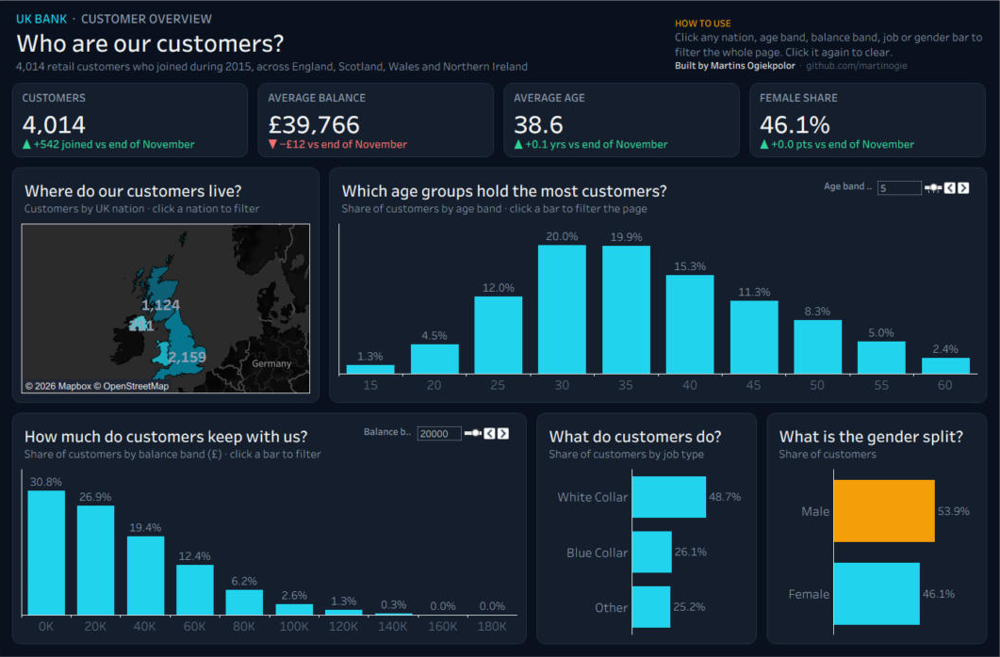

# UK Bank Customer Dashboard (Tableau)

A one-page customer profile for a UK retail bank, built in **Tableau Public**. It answers the questions a
retail-banking or marketing team asks first about its customer base: where customers live, how old they
are, how much they keep with the bank, what they do for a living and the gender mix.

**Live dashboard:** [UK Bank Customer Dashboard on Tableau Public](https://public.tableau.com/app/profile/martins.ogiekpolor/viz/UKBankCustomerDashboard/Dashboard1)  
**Project page:** [martinogie.github.io/uk-bank-customer-dashboard](https://martinogie.github.io/uk-bank-customer-dashboard/)

## What it shows

| Section | Question it answers |
|---|---|
| KPI cards | How many customers, average balance, average age and female share, each with an arrow against the customer base at the end of the previous month (green up, red down) |
| Map | Where do our customers live? (England, Scotland, Wales, Northern Ireland) |
| Age distribution | Which age groups hold the most customers? (band width set with a slider) |
| Balance distribution | How much do customers keep with us? (band width set with a slider) |
| Job type | What do customers do? (sorted bars) |
| Gender | What is the gender split? |

Click any nation, age band, balance band, job or gender bar to filter the whole page, including the KPI
cards. Click it again to clear.

## How the KPI comparison works

Each customer has a join date (all in 2015). The cards compare the full customer base with the base as it
stood at the end of the month before the latest join month:

- `Join date = DATEPARSE('dd.MMM.yy', [Date Joined])`
- `Latest month start = DATETRUNC('month', {MAX([Join date])})`
- `Joined before latest month = [Join date] < [Latest month start]`
- Prior average balance, for example: `AVG(IF [Joined before latest month] THEN [Balance] END)`

The arrow and colour come from the sign of the difference, so they update when the page is filtered.

## Design

Dark theme: near-black page `#0B1120`, card `#151E2E` with rounded corners, cyan `#22D3EE` bars, amber
`#F59E0B` accent, and green `#34D399` / red `#F87171` change arrows. Every chart has a question-style
title and data labels.

## Files

| File | Contents |
|---|---|
| `tableau/UK_Bank_Customer_Dashboard.twbx` | Packaged workbook (includes the data extract), opens in Tableau Public or Desktop |
| `images/dashboard.png` | Screenshot of the dashboard |
| `index.html` | Project page (GitHub Pages) with the embedded live dashboard |

## Data note

Sample dataset of 4,014 UK retail bank customers (customer ID, gender, age, region, job classification,
join date and balance). Names and IDs are fictional. Built with AI-assisted coding; the analysis
questions, design and review are my own.

## License

MIT
